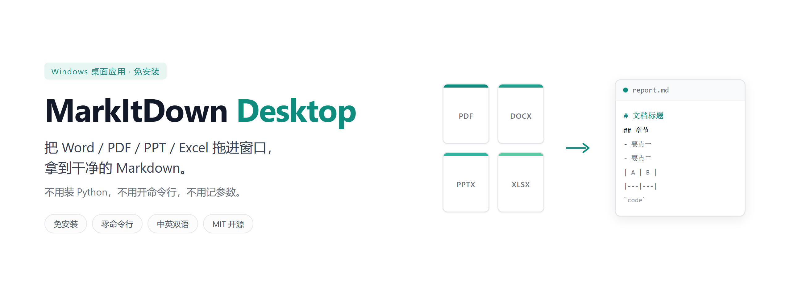
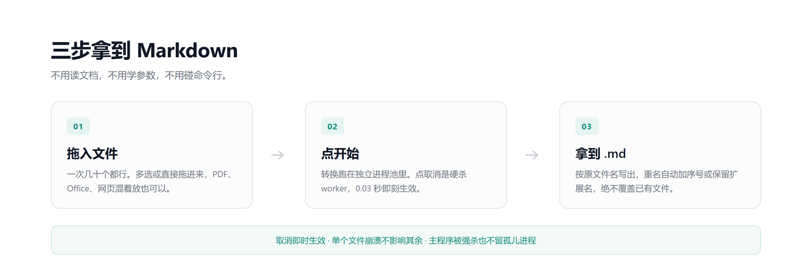
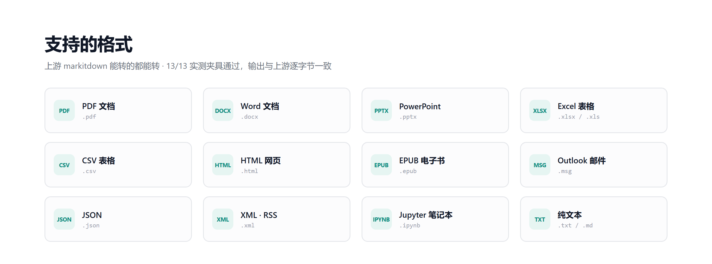
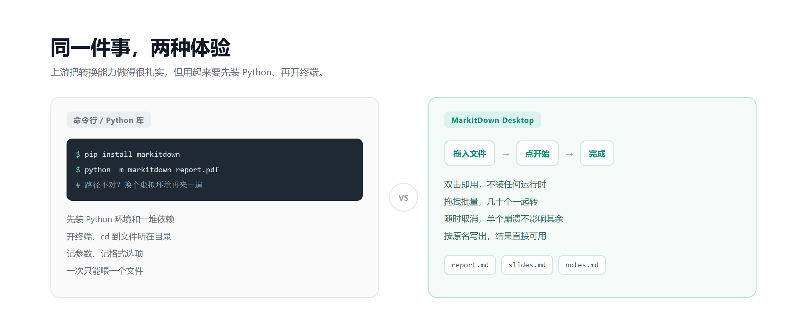

# MarkItDown Desktop

**把 Word / PDF / PPT / Excel 拖进窗口，拿到干净的 Markdown。免装 Python、免命令行、双击即用。**

> *A Windows desktop GUI for Microsoft MarkItDown — drag documents in, get Markdown out. No Python, no command line.*

[](https://github.com/it-kxw/markitdown-desktop/releases/latest)
[](LICENSE)
[](#已知边界)
[](https://github.com/it-kxw/markitdown-desktop/actions/workflows/ci.yml)



## 来源与许可（请先读这段）

- **本项目不是微软官方项目**，与 Microsoft 及 MarkItDown 上游团队**无隶属、无背书关系**。
- **转换能力全部来自上游开源项目 [MarkItDown](https://github.com/microsoft/markitdown)**（PyPI 包名 `markitdown`，**MIT** 许可）。本项目**通过 PyPI 依赖它，没有复制、没有修改上游源码**；所有格式解析、内容提取的行为与缺陷都归属上游。
- **本项目自身代码同样以 MIT 许可发布**，全文见 [LICENSE](LICENSE)。随包分发的第三方组件中 **Qt/PySide6 为 LGPL-3.0**（动态链接、未修改源码），另有 pandas、numpy、Pillow、lxml、magika、onnxruntime、pdfminer.six、python-docx、openpyxl 等，完整清单与许可证正文见 [THIRD-PARTY-NOTICES.md](THIRD-PARTY-NOTICES.md)。
- **名称与商标**：`MarkItDown` 是上游项目的名称，本项目仅用它说明来源与用途，不主张任何权利。

> 上游把桌面 GUI 明确列为 *out of scope*，同时**明确鼓励**以「独立项目 + 依赖 PyPI 上的 `markitdown`」的方式实现 —— 本项目就是这条路径。

## 下载

| 方式 | 文件 | 大小 | 说明 |
| --- | --- | --- | --- |
| **安装包（推荐）** | [`MarkItDownDesktop-0.1.1-setup.exe`](https://github.com/it-kxw/markitdown-desktop/releases/download/v0.1.1/MarkItDownDesktop-0.1.1-setup.exe) | 64.32 MB | 装到用户目录，**免 UAC**；带开始菜单项与卸载程序 |
| **免安装 zip** | [`MarkItDownDesktop-0.1.1-portable.zip`](https://github.com/it-kxw/markitdown-desktop/releases/download/v0.1.1/MarkItDownDesktop-0.1.1-portable.zip) | 93.20 MB | 解压后双击 `markitdown-desktop.exe`，不写注册表 |

👉 **[前往 Releases 下载最新版](https://github.com/it-kxw/markitdown-desktop/releases/latest)**

**首次运行被 SmartScreen 拦了？** 点「更多信息」→「仍要运行」即可。安装包**当前未做代码签名**（原因与后续计划见[已知边界](#已知边界)），Release 说明里附了**真实产物的 SHA-256**，可以先校验再运行：

```powershell
Get-FileHash .\MarkItDownDesktop-0.1.1-setup.exe -Algorithm SHA256
```

## 它解决什么问题

上游 `markitdown` 是个 Python 库 / 命令行工具，对不写代码的人不可用：要装 Python、开命令行、记参数。本项目把它变成**双击就能用的 Windows 程序**：拖文件、选输出目录、拿到 `.md`。

**而最常见的用法，是转出来喂给大模型。** 把 PDF 直接丢给 ChatGPT / Claude / Cursor，表格和排版会丢；先转成 Markdown 再喂，结构完整、token 还更省。这个工具就是为这类场景准备的。

## 三步拿到 Markdown



## 功能

| 功能 | 说明 |
| --- | --- |
| 拖拽批量转换 | 一次拖入几十个文件，格式可以混着放；列表里能看到每个文件的状态、进度与耗时 |
| 随时取消 | 点「取消」立即停下，不用等当前文件跑完 |
| 单文件故障隔离 | 某个文件卡住或出错，其余文件照常完成；单个文件的超时阈值可自己设 |
| 并发可调 | 同时转换 1–4 个文件（默认 2），自己权衡速度与内存 |
| 重名不覆盖 | 遇到同名文件自动加序号（`a (1).md`）或保留扩展名（`a.docx.md`），不会覆盖已有文件 |
| 结果可预览 | 转换完成后先在界面里看结果，再决定要不要保存 |
| 批量另存为 | 选中多行「另存为 .md…」，指定一个文件夹，按原文件名批量写出 |
| 失败可单独重试 | 只重跑失败项，已成功行的结果与预览都保留 |
| 空结果会提示 | 转出来是 0 字符时明确告知，不静默产出空文件 |
| 界面中英双语 | 中／英随时切换，错误提示一并切换 |
| 深色模式 | 跟随系统 / 浅色 / 深色三态，设置里随时切换 |
| 界面清爽 | 顶部动作条、文件类型图标、状态配色、空状态引导卡；一个主按钮，其余降级 |
| 设置自动记住 | 输出目录、命名规则、并发数、界面语言、外观，改完即生效并持久化 |
| 出错可排查 | 失败原因写入本地日志，可一键导出；只记路径与原因，不记文件内容 |

## 支持的格式



`markitdown` 能转的都能转（PDF、Word、PowerPoint、Excel、CSV、HTML、EPUB、Outlook MSG、JSON、XML/RSS、Jupyter Notebook、文本类等），外加**含链接图片的 docx** 等边界场景。上游支持范围见其 README；本项目的实测矩阵见下节。

刻意**不使用** `markitdown[all]`（会拖入 Azure SDK 与约 31 MB 的 `SpeechRecognition`）：

```toml
"markitdown[pdf,docx,pptx,xlsx,xls,outlook,youtube-transcription]>=0.1.8,<0.2.0"
"PySide6-Essentials>=6.8"    # 不用 PySide6-Addons（省约 39 MB）
```

音频转写作为可选 extra（`pip install .[audio]`），因为它还需要外部 `ffmpeg`。

## 为什么不用命令行



## 实测数据（Windows 11 x64，Python 3.12，PyInstaller 6.22.3）

| 指标 | 实测值 |
| --- | --- |
| one-folder 产物 | **211.5 MB**（默认裁剪档 `safe`） |
| Inno Setup 安装包 | **64.32 MB**（per-user，免 UAC） |
| 免安装 zip | **93.20 MB**（解压即用，不写注册表） |
| 冷启动（进程启动 → 窗口可交互） | **0.947 s**（3 次中位数） |
| GUI 常驻内存 | **160.2 MB**（并发 2 峰值 438.4 MB） |
| 取消响应 | **0.03 s**（硬杀 worker） |
| 格式矩阵 | 13/13 夹具通过，输出字符数与上游逐字节一致 |

## 快速开始（开发运行）

```powershell
# 1) 建环境（需要 Python 3.12）
uv venv --python 3.12 .venv
uv pip install --python .venv\Scripts\python.exe -e ".[dev]"

# 2) 直接运行 GUI
.venv\Scripts\python.exe -m markitdown_desktop

# 3) 无界面自测（输出 JSON 报告，用于测量启动与转换耗时）
.venv\Scripts\python.exe -m markitdown_desktop --selftest test.pdf test.docx --offscreen --json report.json
```

## 打包

```powershell
# one-folder（默认 safe 裁剪档）
.venv\Scripts\python.exe -m PyInstaller --noconfirm --clean packaging\markitdown-desktop.spec

# 可选裁剪档：none | safe | aggressive（明细写入 dist\trim-report.txt）
$env:MDD_TRIM = "aggressive"
.venv\Scripts\python.exe -m PyInstaller --noconfirm --clean packaging\markitdown-desktop.spec

# 出安装包（PyInstaller → Inno Setup → 体积检查；需要 Inno Setup 6）
powershell -ExecutionPolicy Bypass -File scripts\build_installer.ps1

# 出免安装 zip（复用已有 one-folder 加 -SkipPyInstaller）
powershell -ExecutionPolicy Bypass -File scripts\build_portable.ps1
```

### 体积裁剪（`MDD_TRIM`）

| 档位 | one-folder | 说明 |
| --- | --- | --- |
| `none` | 233 MB | 基线，用于对比 |
| **`safe`（默认）** | **213 MB** | 只裁 UI 渲染与网络栈用不到的文件：Qt 翻译（保留 en/zh_CN）、Pillow AVIF、QtNetwork、sqlite3、Qt TLS/网络信息插件、部分图像格式插件 |
| `aggressive` | 192 MB | 额外裁 `opengl32sw.dll`（20 MB 软件 OpenGL 回退）与 `qdirect2d`；**无 GPU 的 VM/RDP 未验证** |

> **裁剪原则：只减冗余，不减功能。** `magika`/`onnxruntime`（内容嗅探）、`pandas`/`numpy`（Excel）、PDF 栈、Office 栈、`lxml` 等**全部保留**，不改上游行为、不降级依赖。两档裁剪的格式支持与未裁剪基线**完全一致**（同一套用例全过）。

## 架构：三层解耦

| 层 | 文件 | 约束 |
| --- | --- | --- |
| 纯逻辑 | `engine.py` | **不导入 PySide6**，可脱离 GUI 单测 |
| 并发 | `worker.py` + `_child.py` | **不导入 Qt**；用 `multiprocessing(spawn)` 而不是 `QThread`，才能硬杀 |
| 展示 | `ui.py` | 只做展示与交互，不做转换 |

为什么用进程池而不是线程：转换是 CPU/IO 混合的重活，且上游库在异常时可能残留状态；**能硬杀**是"取消要立刻生效"和"崩溃要隔离"的前提（P0 的 `QThread` 版做不到，实测取消要等它自己跑完）。

这套结构还顺带解决了两件事：**主程序被强杀**（含启动瞬间）时，worker 会在 1~2 s 内自退，不留孤儿进程；并发每 +1 约多占 140 MB 内存。

## 已知边界

没做、或没验证的，这里不写成"已支持"：

- **只处理本地文件，不联网转换**：拖进去的就是本机路径。上游支持的远程 URL / 网页 /
  YouTube / RSS / Wikipedia 输入**本仓没有入口**（转换器其实都在包里，只缺 UI 与引擎那一层）。
  这也是"文件不出本机"这句话的由来。
- **没有代码签名** → 首次运行会弹 SmartScreen，杀软可能误报，这是当前最大的用户侧信任问题。
  **签名路线已定：SignPath Foundation（对开源项目免费）**，2026-10-15 已提交申请、等回复。
- **没有自动更新**（下载 + 静默升级涉及 UAC 与回滚，风险大于收益）。
- **图片默认「转换成功但 0 字符」**：上游要 exiftool 或 LLM 描述才能提取内容，两者都没接。
- **音频转写要手动装额外依赖**（`pip install markitdown-desktop[audio]`，另需 `ffmpeg`），默认包不含。
- **切换界面语言需要重启**（改完会提示，并给「立即重启」按钮）。
- **无 GPU 的 VM / RDP** 上未验证 `aggressive` 裁剪档（缺 `opengl32sw.dll`）。
- 只在 **Windows 11 x64** 上实测；Windows 10、ARM64 未验证（因此 winget 清单里不写 `MinimumOSVersion`）。

完整的未做清单见下一节「未来计划」。

## 未来计划

### 下一步候选

| 优先级 | 事项 | 说明 |
| --- | --- | --- |
| **P1** | **URL 输入** | 上游的远程文件 / 网页 / YouTube / RSS / Wikipedia 输入。**转换器都已在包里，只缺入口** —— 一次改动能点亮 5 个能力。 |
| **P2** | 插件机制 | `enable_plugins` 目前是死参数；且冻结包里没有插件可装，entry point 发现未实测 |
| **P2** | 音频转写默认可用 | 需要 31 MB 级依赖 + ffmpeg |
| **P2** | 图片 OCR / EXIF | 需要 exiftool 二进制或 LLM 密钥 |
| **P3** | 图片描述 / Azure DocIntel / Content Understanding | 需要密钥与计费 |
| **P4** | 转换 CLI（`-o`、`--extension` 等）| 本仓 CLI 目前只用于自检；加转换能力与"GUI 应用"定位有张力 |

### CI（GitHub Actions）

`.github/workflows/ci.yml`（`windows-latest` + Python 3.12）在每次 push 时：

装依赖 →（仓库含 `tests/` 时才）跑单元测试 → **现场生成 CI 夹具** → PyInstaller 打包 →
冻结包 `--selftest --offscreen` → 校验每个夹具的转换结果 → **体积闸门**（one-folder ≤ 213 MB）→ 上传报告。

夹具由 `scripts/ci_fixtures.py` 用「运行期已有依赖 + 标准库」现场生成（docx / xlsx / pptx / pdf /
html / csv / json / xml / txt 共 9 个），**不引入新依赖**，CI 也不依赖仓库里的二进制夹具。
安装包与免安装 zip 只在手动触发并勾选 `full` 时构建。

打 `v*` tag 时 `.github/workflows/release.yml` 会出安装包 + 免安装 zip 并挂到 Release。
该工作流已在 `v0.1.0` / `v0.1.1` 上**真跑通过**，且是**幂等**的——同一个 tag 重跑会覆盖附件、更新说明，不会因为「Release 已存在」失败。

## 项目结构

本仓库的发布分支只包含**运行需要的文件**（开发用的设计文档与测试套件在内部分支，不随发布集公开）：

```text
src/markitdown_desktop/
  __init__.py        # 最先执行 _compat.preload_heavy_deps()
  _compat.py         # shiboken6 × six.moves 导入冲突修复（见上方"坑"）
  engine.py          # ConversionEngine：上游 convert 封装、错误明细、编码重试、UTF-8 写盘
  worker.py          # ConversionPool：进程池（硬杀取消、超时看门狗、崩溃隔离）
  _child.py          # 子进程入口（零 Qt 导入）+ 父进程看门狗
  settings.py        # AppSettings：输出目录/命名策略/并发度/窗口几何/语言 持久化
  i18n.py            # 中英字符串表（零 Qt、零第三方依赖，子进程不导入）
  logging_setup.py   # 日志落盘 + 全局异常钩子 + 一键导出
  settings_dialog.py # 设置对话框
  ui.py              # MainWindow：拖拽队列 + 进程池 + 取消 + 预览 + 关闭确认
  update_check.py    # 「检查更新」：只读版本号，不下载任何东西
  __main__.py        # GUI 入口 + --selftest 自测模式（inproc / pool）
packaging/
  run.py                   # PyInstaller 入口：装看门狗 → freeze_support()（失败即 os._exit）→ main()
  markitdown-desktop.spec  # one-folder 打包配置（magika 数据 / 元数据 / 体积裁剪）
  installer.iss            # Inno Setup 安装包脚本（per-user 免 UAC，需带 UTF-8 BOM）
  release-notes.md         # Release 说明模板（体积与 SHA-256 由真实产物填充）
  languages/               # 简体中文向导语言文件（Inno 自带语言里没有中文）
  icon/                    # 应用图标（矢量源 + ICO）
scripts/
  build_installer.ps1        # 一键：PyInstaller → Inno Setup → 体积检查
  build_portable.ps1         # 一键：PyInstaller → 补合规文件 → Deflate zip → 体积检查
  gen_third_party_notices.py # 生成 THIRD-PARTY-NOTICES.md + licenses/
  p0_verify.py / p1_verify.py # 转换→写盘→失败路径 / 冻结包行为验证
  smoke_matrix.py            # 源码/冻结 × 并发 1/2 冒烟矩阵，逐文件比对字符数
THIRD-PARTY-NOTICES.md     # 【生成物，勿手改】第三方通告
licenses/                  # 【生成物，勿手改】一包一目录的许可证正文
```

## 检查更新

「帮助 → 检查更新…」会去读本项目的 GitHub 发布页（**只读版本号，不下载任何东西**），启动时也会自动检查一次，可以在「设置…」里关掉。

- 只发一个固定的 `User-Agent`，**不带**机器名 / 用户名 / 路径等任何信息；
- 网络不通时显示「无法检查更新」，**不会报错、不会卡界面**；
- **不会**自动下载或安装新版本（自动更新要处理 UAC 与回滚，风险大于收益）。

## 致谢

- [Microsoft MarkItDown](https://github.com/microsoft/markitdown) —— 全部转换能力来自它；
- [Qt / PySide6](https://www.qt.io/) —— 界面；
- 以及 pandas、numpy、Pillow、lxml、magika、onnxruntime、pdfminer.six、python-docx、openpyxl 等上游依赖的作者们。完整清单与许可证见 [THIRD-PARTY-NOTICES.md](THIRD-PARTY-NOTICES.md)。

## 许可证

MIT，见 [LICENSE](LICENSE)。本项目是独立第三方项目，与 Microsoft 无关。
